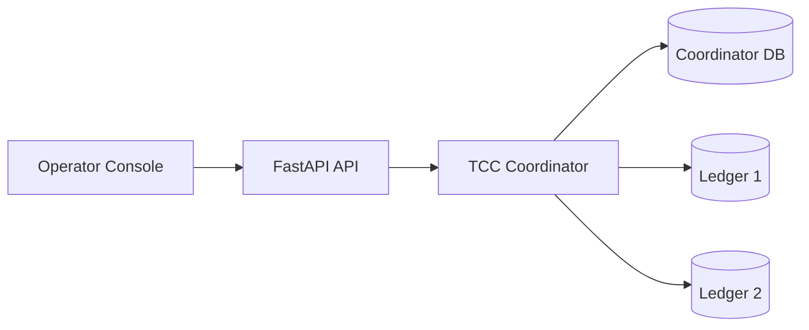
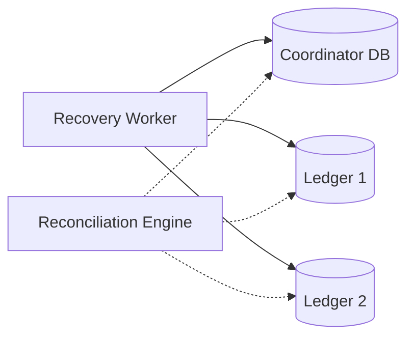
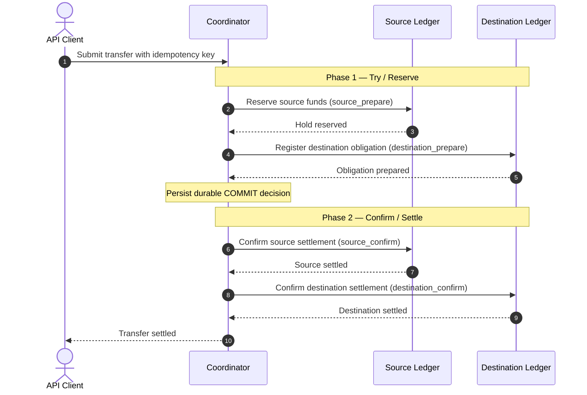

<div align="center">

# LedgerGuard

<p><strong>A multi-database financial ledger and operator console demonstrating immutable double-entry bookkeeping, TCC-style reserve/confirm/cancel transfer coordination, and continuous cross-ledger reconciliation.</strong></p>

<p><em>Built with Python 3.12, FastAPI, PostgreSQL 17, and Next.js 15.</em></p>

<p>
  <a href="LICENSE"></a>
  <a href="https://www.python.org/"></a>
  <a href="https://fastapi.tiangolo.com/"></a>
  <a href="https://www.postgresql.org/"></a>
  <a href="https://nextjs.org/"></a>
  <a href="https://docs.docker.com/compose/"></a>
</p>

</div>

---

## Table of Contents

- [Project Overview](#project-overview)
- [Key Features](#key-features)
- [System Architecture](#system-architecture)
- [Transfer Protocol](#transfer-protocol)
- [Accounting & Recovery Invariants](#accounting--recovery-invariants)
- [Failure Recovery Scenario](#failure-recovery-scenario)
- [Operator Console](#operator-console)
- [Technology Stack](#technology-stack)
- [Quick Start](#quick-start)
- [Verification & Test Suite](#verification--test-suite)
- [Benchmark Baseline](#benchmark-baseline)
- [Project Structure](#project-structure)
- [Security & Scope Disclosures](#security--scope-disclosures)
- [Environment Configuration](#environment-configuration)
- [Documentation & Decision Records](#documentation--decision-records)
- [License](#license)

---

## Project Overview

**LedgerGuard** is an educational and portfolio reference implementation of a multi-database financial ledger and operator console. It demonstrates how distributed systems principles and database constraints combine to enforce accounting integrity across autonomous storage boundaries.

The core architecture coordinates balance movements across three isolated PostgreSQL 17 database instances: a **Coordinator** managing account routing and durable decision logs, and two independent **Participant Ledgers** maintaining localized double-entry accounting kernels. Distributed transfers use an application-level **Try-Confirm-Cancel (TCC)** workflow with durable forward recovery rather than classical distributed transaction managers (XA 2PC). Each participant operation executes and commits as an independent, locally atomic PostgreSQL transaction, preventing distributed lock stalls across network calls while ensuring that once a transfer decision is logged, the system recovers forward to settlement with zero duplicate financial effect.

---

## Key Features

### Core Capabilities

| Capability | Implementation & Mechanism | Verified Guarantee |
| :--- | :--- | :--- |
| **Immutable Double-Entry** | Database triggers (`trg_prevent_journal_modification`) reject `UPDATE`, `DELETE`, and `TRUNCATE` on journals. | Posted records cannot be mutated or purged; corrections require explicit compensating entries. |
| **Balanced Postings** | Trigger `trg_verify_journal_balanced` checks that each journal has $\ge 2$ lines and balances to exact zero per currency. | $\sum \text{amount} = 0$ enforced at transaction commit time. |
| **Integer Minor Units** | Domain model `AmountPaise` represents currency in integer paise within $[1, 100\,000\,000\,000]$. | Eliminates floating-point rounding errors; float/boolean inputs are strictly rejected. |
| **Concurrency Control** | Row-level locking ordered by `account_id ASC` (`SELECT ... FOR UPDATE`) in PL/pgSQL procedures. | Eliminates deadlocks between concurrent bidirectional transfers; prevents double-spending. |
| **Idempotent APIs** | Request hashing with canonical SHA-256 fingerprints stored in `idempotency_keys` table. | Identical requests return cached responses; modified payloads return `409 Conflict`. |
| **TCC Transfer Coordination** | Two-phase workflow: Phase 1 reserves funds (hold) and registers intent; Phase 2 settles. | Decentralized coordination without distributed database locks; zero premature refunds after commit. |
| **Continuous Reconciliation** | Multi-database audit engine checking inter-ledger clearing conservation ($\sum \text{Clearing} = 0$). | Identifies ledger discrepancies and orphaned holds; detects partial cluster reachability. |

### Engineering Depth

| Mechanism | Description | System Location |
| :--- | :--- | :--- |
| **Transactional Outbox** | Events written in the same transaction as state changes; polled via `SELECT ... FOR UPDATE SKIP LOCKED`. | [`src/ledgerguard/worker/outbox.py`](src/ledgerguard/worker/outbox.py) |
| **Command Inbox** | Participants deduplicate incoming commands by unique command ID before execution. | [`migrations/ledger/005_intents_holds_inbox_outbox.sql`](migrations/ledger/005_intents_holds_inbox_outbox.sql) |
| **Cancellation Tombstones** | Out-of-order `CANCEL` writes a durable tombstone, causing late `PREPARE` messages to safely reject. | [`docs/adr/0003-tombstone-semantics-and-unresolved-obligations.md`](docs/adr/0003-tombstone-semantics-and-unresolved-obligations.md) |
| **Unresolved Obligation Guards** | Account closure (`CLOSED`) is blocked by triggers if active holds or prepared intents exist. | [`migrations/ledger/006_closure_unresolved_obligations.sql`](migrations/ledger/006_closure_unresolved_obligations.sql) |
| **PostgreSQL Role Separation** | Migration owner (`ledgerguard_admin`) vs application runtime (`ledgerguard_app`). | Direct table DML denied to app role; execution restricted to stored functions. |
| **Property-Based Testing** | Hypothesis stateful testing verifying that parallel transfers match an in-memory reference model. | [`tests/test_reference_model.py`](tests/test_reference_model.py) |

---

## System Architecture

The following diagram illustrates the request and transfer path across runtime services and database boundaries:



- **Coordinator DB** stores routing, idempotency, workflow state, and durable decisions.
- **Ledger 1** and **Ledger 2** independently enforce their accounting journals, holds, and transfer obligations.

### Recovery and Reconciliation



- Solid connections represent durable recovery work.
- Dotted connections represent read-only reconciliation probes.
- All three databases remain isolated PostgreSQL 17 instances bound to loopback:
  - **Coordinator DB:** `127.0.0.1:5442`
  - **Ledger 1:** `127.0.0.1:5443`
  - **Ledger 2:** `127.0.0.1:5444`

### Why Independent Databases and Durable Messaging Matter

In distributed financial architectures, individual ledgers often represent distinct legal entities, clearinghouses, or microservice failure domains. Holding database connections or distributed locks across independent networks introduces severe operational coupling: a slow query or network partition in one ledger can exhaust connection pools and freeze unrelated transfers across the cluster.

LedgerGuard eliminates distributed locking by treating each ledger as an autonomous system. Balance reservations and journal postings commit in local database transactions. Inter-ledger consistency is maintained via durable decision logging at the coordinator and transactional outbox/inbox worker recovery.

---

## Transfer Protocol

Cross-ledger transfers execute using an application-level **Try-Confirm-Cancel (TCC)** protocol with source-first settlement and forward recovery:



### Protocol Guarantees & Distinction from Database XA 2PC

- **Application-Level TCC vs. XA 2PC:** Classical database XA 2PC keeps database transactions open between Phase 1 (`PREPARE TRANSACTION`) and Phase 2 (`COMMIT PREPARED`), holding table and row locks across network round-trips. In LedgerGuard, all participant operations (`source_prepare`, `destination_prepare`, `source_confirm`, `destination_confirm`) execute as separate, locally atomic PostgreSQL transactions that commit immediately.
- **Durable Decision Invariant:** Once the coordinator commits the `COMMIT` record to `transfer_decisions`, the outcome is immutable. Even if the coordinator crashes immediately afterward, the transfer is never rolled back or refunded to the source.
- **Autonomous Forward Recovery:** Background workers inspect unconfirmed transfers in `COMMITTING` state and re-deliver Phase 2 confirmations until both ledgers reach settlement.
- **Tombstone Semantics:** If a cancellation arrives at a participant before the corresponding prepare (due to network reordering), a durable `CANCELLED` tombstone is written. Any subsequent delayed prepare is rejected immediately with zero funds reserved.

---

## Accounting & Recovery Invariants

Every financial operation in LedgerGuard is constrained by invariants enforced at the database and application levels:

| Invariant | Enforcement | Verified By |
| :--- | :--- | :--- |
| **Balanced Journal**<br>$\sum \text{lines}=0$ | Commit-time PostgreSQL trigger validates balanced lines per currency. | [`tests/test_accounting_kernel.py`](tests/test_accounting_kernel.py) |
| **Journal Immutability**<br>$\Delta \text{posted records} = \varnothing$ | Database trigger blocks `UPDATE`, `DELETE`, and `TRUNCATE` operations. | [`tests/test_accounting_kernel.py`](tests/test_accounting_kernel.py) |
| **Integer Minor Units**<br>$\text{amount} \in [1, 10^{11}] \subset \mathbb{Z}^+$ | Domain validation in `AmountPaise`; database checks enforce `BIGINT > 0`. | [`tests/test_accounting_kernel.py`](tests/test_accounting_kernel.py) |
| **No Double-Spending**<br>$\text{available} \ge 0$ | Sorted row locks (`account_id ASC`) inside PL/pgSQL procedures. | [`tests/test_local_transfers.py`](tests/test_local_transfers.py) |
| **Idempotent Replay** | Unique constraint on `(idempotency_key, scope)` with SHA-256 payload hash verification. | [`tests/test_local_transfers.py`](tests/test_local_transfers.py) |
| **Forward Recovery** | Autonomous orchestrator queries unconfirmed decisions and executes settlement. | [`tests/test_distributed_failures.py`](tests/test_distributed_failures.py) |
| **Compensating Reversals** | Reversals post a new balanced journal with a backlink reference. | [`tests/test_local_transfers.py`](tests/test_local_transfers.py) |
| **Clearing Conservation**<br>$\sum \text{Clearing} = 0$ | Cross-ledger audit verifies zero-sum clearing balances across ledgers. | [`tests/test_audit_reconciliation.py`](tests/test_audit_reconciliation.py) |

---

## Failure Recovery Scenario

LedgerGuard includes a deterministic failure demonstration script illustrating crash resilience and forward recovery:

```bash
./scripts/demo_signature_recovery.sh
```

### Demonstration Sequence: Interrupted TCC Recovery

1. **Provisioning:** Creates source account Alice on Ledger 1 (funded with ₹1,000.00) and destination account Bob on Ledger 2 (₹0.00).
2. **Transfer Initiation:** Submits a ₹400.00 transfer with failpoint `FAIL_AFTER_COMMIT_BEFORE_SOURCE_CONFIRM`.
3. **Simulated Crash:** The coordinator executes Phase 1 (reserving ₹400.00 on Ledger 1), durably writes `decision = COMMIT`, and simulates a crash before Phase 2 confirmation commands are sent.
4. **Invariant Inspection During Outage:**
   - Coordinator transfer state: `COMMITTING` (Decision committed on disk).
   - Alice hold on Ledger 1: `ACTIVE` hold of ₹400.00 preserved (no premature refund).
   - Alice available balance: Reduced to ₹600.00.
   - Bob balance on Ledger 2: ₹0.00 (awaiting confirmation).
5. **Forward Recovery:** Autonomous recovery worker detects the unconfirmed transfer, executes source confirmation, then destination confirmation.
6. **Final State Verification:**
   - Alice final balance: ₹600.00 (Active hold: ₹0.00).
   - Bob final balance: ₹400.00 (Exact credit).
   - Inter-ledger clearing: $\Delta L_1 (-₹400.00) + \Delta L_2 (+₹400.00) = ₹0.00$ (exact conservation).

---

## Operator Console

LedgerGuard includes a Next.js 15 operator console providing visibility into ledger health, accounts, transfers, and reconciliation:

| Screen | Primary Functionality | Operator Controls |
| :--- | :--- | :--- |
| **Overview** | System topology, database reachability indicators, aggregate assets, liabilities, and clearing sum. | Auto-refresh toggle, manual refresh, cluster status cards. |
| **Accounts Explorer** | Multi-ledger directory of customer wallets with posted, held, and available balances. | Account status filters, double-entry statement ledger modal. |
| **Transfer Explorer** | Transaction audit feed displaying transfer lifecycle states and workflow event timelines. | Transfer detail modal, TCC transfer lifecycle stepper, manual reversal action. |
| **Reconciliation Runner** | On-demand cross-database audit verifying inter-ledger clearing balances and active holds. | "Run Reconciliation" trigger, partial reachability detection, discrepancy viewer. |
| **Experiment Console** | Interactive failure-injection testbed simulating coordinator crashes and network timeouts. | Preset fault injection scenarios, execution stepper, final invariant inspection. |

---

## Technology Stack

| Layer | Component | Version | Purpose |
| :--- | :--- | :--- | :--- |
| **Backend** | Python | 3.12+ | Core programming language |
| | FastAPI | 0.115+ | High-performance asynchronous REST API framework |
| | Psycopg 3 | 3.2+ | Native PostgreSQL driver with connection pooling (`psycopg_pool`) |
| | Pydantic | 2.9+ | Strict type validation and domain schema enforcement |
| **Database** | PostgreSQL | 17-alpine | Primary relational storage engine across 3 isolated instances |
| | PL/pgSQL | 17 | Atomic stored procedures, mutation triggers, and row-level locks |
| **Workflow & Reliability** | Transactional Outbox | Custom | Reliable asynchronous event publication via `SKIP LOCKED` |
| | Command Inbox | Custom | At-least-once command deduplication on participant ledgers |
| | TCC Coordinator | Custom | Two-phase reserve/confirm/cancel coordinator with forward recovery |
| **Testing & Quality** | Pytest | 8.3+ | Automated test runner with async fixture support |
| | Hypothesis | 6.115+ | Property-based testing against an in-memory reference model |
| | Ruff | 0.7+ | Fast Python linter and code formatter |
| | Mypy | 1.13+ | Static type checker verifying strict typing across 27 source files |
| **Frontend** | Next.js | 15.5.28 | React App Router frontend framework |
| | React / React DOM | 18.3.1 | UI component rendering library |
| | TypeScript | 5.4+ | Typed client application code |
| | PostCSS | 8.5.32 | CSS processing (overridden to resolve security advisories) |
| **Tooling & Infra** | Docker & Compose | v2 | Container orchestration for isolated database instances |
| | Astral uv | Latest | Fast Python package management and virtual environment tooling |
| | Make | Standard | Consolidated developer task automation |

---

## Quick Start

### Prerequisites

- macOS or Linux
- Python 3.12+ with [`uv`](https://github.com/astral-sh/uv)
- Docker Engine & Docker Compose v2
- Node.js 20+ & npm

### 1. Clone the Repository

```bash
git clone https://github.com/simply-mihir/LedgerGuard.git
cd LedgerGuard
```

### 2. Configure Environment

```bash
cp .env.example .env
```

> [!NOTE]
> The credentials documented in `.env.example` and `docker-compose.yml` (e.g. `ledgerguard_app_secret`, `ledgerguard_admin_secret`) are disposable defaults intended exclusively for isolated local development and testing. Real `.env` files are excluded by `.gitignore`.

### 3. Start PostgreSQL 17 Databases

Start the three isolated database containers (Coordinator, Ledger 1, Ledger 2):

```bash
docker compose up -d
```

Verify that all three database containers report healthy:

```bash
docker compose ps
```

*Note: Database ports bind exclusively to loopback (`127.0.0.1:5442`, `127.0.0.1:5443`, `127.0.0.1:5444`) to prevent external network exposure.*

### 4. Install Dependencies

Install Python dependencies in a managed virtual environment:

```bash
uv sync --extra dev
```

Install Next.js console dependencies:

```bash
cd apps/console
npm ci
cd ../..
```

### 5. Apply Database Migrations

Apply database schemas and stored procedures across all three database instances:

```bash
uv run python -m ledgerguard.cli migrate --target all
```

### 6. Start the API Server

Launch the FastAPI coordinator and operator service bound to loopback:

```bash
uv run uvicorn ledgerguard.api.app:app --host 127.0.0.1 --port 8010 --reload
```

- API Health Check: `http://127.0.0.1:8010/health`
- Interactive OpenAPI Docs: `http://127.0.0.1:8010/docs`

### 7. Launch the Operator Console

In a separate terminal, start the Next.js development server:

```bash
cd apps/console
npm run dev
```

Open **[http://localhost:3300](http://localhost:3300)** in your browser to access the operator console.

### 8. Stopping the Environment

To stop the database containers:

```bash
docker compose down
```

---

## Verification & Test Suite

The test suite validates accounting correctness, concurrency safety, failure recovery, and reconciliation across live PostgreSQL 17 instances.

### Current Repository Baseline (Verified November 2026)

- **Pytest Suite:** 54 passing tests in ~11 seconds (`uv run pytest -ra -W error`)
- **Linting:** 0 Ruff errors (`uv run ruff check .`)
- **Type Checking:** 0 Mypy errors across 27 source files (`uv run mypy src`)
- **Console Build:** Clean Next.js 15 production build (`npm run build`)
- **Production Vulnerabilities:** 0 vulnerabilities (`npm audit --omit=dev`)
- **Signature Recovery Demo:** 8/8 steps and 15/15 checkpoints passing (`./scripts/demo_signature_recovery.sh`)

### Execute Verification Commands

```bash
# Run complete test suite
uv run pytest -ra -W error

# Run code style and lint checks
uv run ruff check .

# Run static type checker
uv run mypy src

# Run signature recovery demonstration
./scripts/demo_signature_recovery.sh

# Build Next.js operator console
cd apps/console && npm run build && cd ../..
```

### Test Suite Map

| Test Module | Tests | Primary Verification Scope |
| :--- | :---: | :--- |
| [`tests/test_accounting_kernel.py`](tests/test_accounting_kernel.py) | 14 | Integer paise bounds, balanced double-entry trigger, journal immutability triggers, role permission boundaries, zero-balance closure rules. |
| [`tests/test_local_transfers.py`](tests/test_local_transfers.py) | 9 | Atomic intra-ledger transfers, idempotency fingerprints, 100 concurrent race spends against balance limit, compensating reversals. |
| [`tests/test_durable_workflow.py`](tests/test_durable_workflow.py) | 7 | Transactional outbox polling via `SKIP LOCKED`, durable coordinator decisions, command inbox deduplication, holds reservation lifecycle. |
| [`tests/test_distributed_failures.py`](tests/test_distributed_failures.py) | 11 | TCC-style failure matrix: lost prepare replies, crash after `COMMIT`, crash between confirms, frozen/closed account rejections, idempotency retries. |
| [`tests/test_audit_reconciliation.py`](tests/test_audit_reconciliation.py) | 4 | Multi-database reachability probing, corrupted hold cache detection, stopped-and-drained full cluster audit. |
| [`tests/test_operator_api.py`](tests/test_operator_api.py) | 5 | REST API endpoints, system overview metrics, workflow timeline inspection, public-safe experiment blocking (`403 Forbidden`). |
| [`tests/test_reference_model.py`](tests/test_reference_model.py) | 1 | Hypothesis stateful property tests comparing concurrent multi-account execution against an in-memory reference model. |
| [`tests/test_smoke.py`](tests/test_smoke.py) | 3 | Live PostgreSQL 17 connectivity, migration tracking tables, application connection role boundary enforcement. |
| **Total** | **54** | **100% Passing** |

---

## Benchmark Baseline

Workload benchmarks measure transaction throughput, acceptance versus settlement latencies, and query plan characteristics against live PostgreSQL 17 instances:

```bash
uv run python scripts/run_benchmarks.py
```

### Recorded Baseline Observations (`docs/benchmarks/baseline_report.md`)

*Recorded on a local Docker-based development environment; results vary by hardware and workload.*

| Workload Scenario | Completed Transfers | Success Rate | Sequential Throughput | Acceptance Latency (p50) | Settlement Latency (p50) | Total Latency (p50) |
| :--- | :---: | :---: | :---: | :---: | :---: | :---: |
| **Uniform Distribution** | 60 | 100.0% | **32.08 TPS** | 7.43 ms | 19.11 ms | 26.54 ms |
| **Hot Account (80% Concentration)** | 60 | 100.0% | **38.19 TPS** | 6.91 ms | 17.76 ms | 24.67 ms |

*Benchmark figures represent an existing recorded baseline of single-threaded sequential client execution from [`docs/benchmarks/baseline_report.md`](docs/benchmarks/baseline_report.md). Results vary depending on host hardware, container configuration, and concurrent workload distribution. Under multi-client concurrent execution, hot accounts will serialize on row locks, resulting in elevated wait times.*

---

## Project Structure

```
LedgerGuard/
├── .env.example                               # Local environment configuration template
├── docker-compose.yml                         # 3-instance PostgreSQL 17 topology
├── Makefile                                   # Development automation targets
├── pyproject.toml                             # Python package manifest, dependencies & tool configs
├── apps/
│   └── console/                               # Next.js 15 operator console
│       ├── app/
│       │   ├── globals.css                    # Console design system & styling
│       │   ├── layout.tsx                     # Root layout & navigation header
│       │   └── page.tsx                       # Operator dashboard (5 interactive screens)
│       └── package.json                       # Next.js, React 18, TypeScript dependencies
├── docker/
│   └── init-roles.sql                         # PostgreSQL roles (ledgerguard_admin, ledgerguard_app)
├── docs/
│   ├── DEMO_SCRIPT.md                         # Presentation walkthrough & live demo guide
│   ├── adr/                                   # Architectural Decision Records (ADRs 0001–0004)
│   ├── architecture/                          # Architecture, protocol, and data model specifications
│   └── benchmarks/                            # Performance baseline reports and query execution plans
├── migrations/
│   ├── coordinator/                           # Coordinator schema migrations (directory, decisions, outbox)
│   └── ledger/                                # Participant ledger migrations (journals, holds, inbox, triggers)
├── scripts/
│   ├── demo_signature_recovery.py             # Deterministic failure injection & forward recovery demo
│   ├── demo_signature_recovery.sh             # Shell runner for the signature recovery demo
│   └── run_benchmarks.py                      # Workload benchmark runner & EXPLAIN ANALYZE generator
├── src/
│   └── ledgerguard/
│       ├── api/                               # FastAPI app factory, routes, auth, and schemas
│       ├── coordinator/                       # Transfer coordinator, directory service, failpoints
│       ├── db/                                # Migration runner and connection pool management
│       ├── domain/                            # Money types, journal templates, idempotency models
│       ├── participant/                       # Account service, posting engine, workflow handlers
│       └── worker/                            # Outbox polling, inbox processing, orchestrator recovery
└── tests/                                     # 54 automated integration, failure, and property tests
```

---

## Security & Scope Disclosures

- **Simulated Financial Environment:** LedgerGuard is an educational reference implementation designed for portfolio and architectural evaluation. It is not connected to live payment rails (UPI, IMPS, NEFT, RTGS, or SWIFT) and does not provide regulatory compliance (e.g., PCI-DSS, SOC 2, or RBI guidelines).
- **Single-Currency Kernel:** The core accounting kernel operates in integer Indian Rupee paise (`INR`). Multi-currency ledgers require foreign-exchange clearing legs.
- **Local Network Isolation:** Database ports in `docker-compose.yml` bind to loopback (`127.0.0.1`), and the API server defaults to loopback binding. In production profiles (`LEDGERGUARD_ENV=production`), fault injection endpoints return `403 Forbidden`.
- **Decentralized Storage:** Cross-database atomicity is achieved through durable application-level coordinator decisions and forward recovery. Global distributed transactions (XA) are deliberately avoided to maintain participant autonomy.

---

## Environment Configuration

The application is configured via environment variables. Copy `.env.example` to `.env` for local configuration:

| Variable | Purpose | Local Value |
| :--- | :--- | :--- |
| `LEDGERGUARD_ENV` | Application environment profile (`local`, `test`, `production`) | `local` |
| `FAULT_INJECTION_ENABLED` | Enables fault-injection endpoints for recovery testing | `false` |
| `COORDINATOR_DB_URL` | Application connection string for Coordinator DB | See `.env.example` |
| `COORDINATOR_ADMIN_DB_URL` | Migration runner connection string for Coordinator DB | See `.env.example` |
| `LEDGER1_DB_URL` | Application connection string for Participant Ledger 1 | See `.env.example` |
| `LEDGER1_ADMIN_DB_URL` | Migration runner connection string for Participant Ledger 1 | See `.env.example` |
| `LEDGER2_DB_URL` | Application connection string for Participant Ledger 2 | See `.env.example` |
| `LEDGER2_ADMIN_DB_URL` | Migration runner connection string for Participant Ledger 2 | See `.env.example` |
| `COORDINATOR_PORT` | HTTP port for the FastAPI coordinator service | `8010` |
| `CONSOLE_PORT` | HTTP port for the Next.js operator console | `3300` |
| `WORKER_POLL_INTERVAL_MS` | Polling interval for transactional outbox background worker | `200` |
| `WORKER_BATCH_SIZE` | Maximum batch size for `SKIP LOCKED` event claiming | `20` |

---

## Documentation & Decision Records

Detailed specifications and architectural rationale are tracked in [`docs/`](docs/):

- [ADR 0001: Immutable Double-Entry Journals & Role Segregation](docs/adr/0001-immutable-journals-and-role-separation.md)
- [ADR 0002: TCC Coordination & Forward Recovery Invariant](docs/adr/0002-two-phase-commit-and-forward-recovery.md)
- [ADR 0003: Durable Tombstone Semantics & Unresolved Obligations](docs/adr/0003-tombstone-semantics-and-unresolved-obligations.md)
- [ADR 0004: Multi-Database Reachability Probing & Clearing Reconciliation](docs/adr/0004-cross-ledger-clearing-reconciliation.md)
- [System Architecture Specification](docs/architecture/system_architecture.md)
- [TCC Transfer Protocol & State Machines](docs/architecture/protocol_2pc.md)
- [Data Models & Schemas](docs/architecture/data_models.md)
- [Benchmark Baseline Report](docs/benchmarks/baseline_report.md)
- [Demonstration & Walkthrough Script](docs/DEMO_SCRIPT.md)

---

## License

This project is licensed under the terms of the [MIT License](LICENSE).

Copyright &copy; 2026 Prateek Raushan.

---

<div align="center">
  <sub>Maintained by <a href="https://github.com/simply-mihir">simply-mihir</a> &bull; Distributed Systems Portfolio Reference</sub>
</div>
