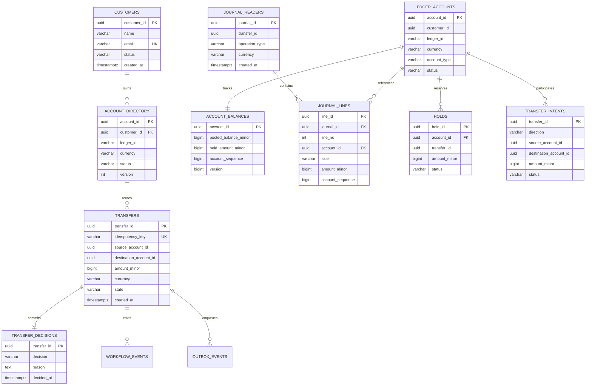

# LedgerGuard Data Models & Database Schemas

## 1. Entity Relationship (ER) Model

LedgerGuard maintains segregated schemas across the Coordinator database and independent Participant Ledger databases:

---

## 2. Table Semantics & Constraints

### 2.1. Participant Ledger Tables

- **`ledger_accounts`**: The authoritative registry of accounts residing on this ledger instance.
  - Types: `LIABILITY` (customer wallets), `ASSET` (platform cash), `CONTROL` (clearing).
  - Normal Sides: `LIABILITY` $\rightarrow$ CREDIT, `ASSET` $\rightarrow$ DEBIT, `CONTROL` $\rightarrow$ CREDIT.
  - Statuses: `ACTIVE`, `FROZEN`, `CLOSED`.
- **`account_balances`**: High-performance row-level lock target and balance cache.
  - `posted_balance_minor`: Sum of debits and credits posted via confirmed journals.
  - `held_amount_minor`: Sum of active holds (`CHECK (held_amount_minor >= 0)`).
  - Customer spendability invariant: $\text{posted} - \text{held} \ge 0$.
- **`journal_headers` & `journal_lines`**: Immutable append-only double-entry financial records.
  - Immutability enforced by `reject_journal_mutation()` trigger.
  - Deferred trigger `trg_verify_journal_balanced` asserts that every committed journal has $\ge 2$ lines and net sum $= 0$.
  - Ordered index `idx_journal_lines_account_seq (account_id, account_sequence)` enables constant-time statement pagination.
- **`holds`**: Durable escrow reservations created during Phase 1 prepare.
  - Statuses: `ACTIVE`, `RELEASED`, `CONSUMED`.
- **`transfer_intents`**: Local participant knowledge of in-flight distributed transfers.
  - Stores `CANCELLED` tombstones when cancellation arrives before prepare.
- **`command_inbox`**: Deduplication barrier for participant commands (at-least-once delivery with single financial effect).
  - Unique constraint on `command_id` ensures deduplicated execution and idempotent response replay.
- **`participant_outbox`**: Transactional outbox table for event dispatch.

### 2.2. Coordinator Tables

- **`customers`**: Platform customer profiles with unique email constraints.
- **`account_directory`**: Three-state account provisioning table (`PROVISIONING`, `READY`, `DECOMMISSIONED`).
- **`api_idempotency`**: Public API idempotency cache storing SHA-256 canonical payload fingerprints.
- **`transfers`**: Distributed transfer lifecycle tracker (`ACCEPTED`, `PREPARING`, `COMMITTING`, `SETTLED`, `CANCELLING`, `CANCELLED`).
- **`transfer_decisions`**: Durable decision log recording `COMMIT` or `CANCEL` under row locks.
