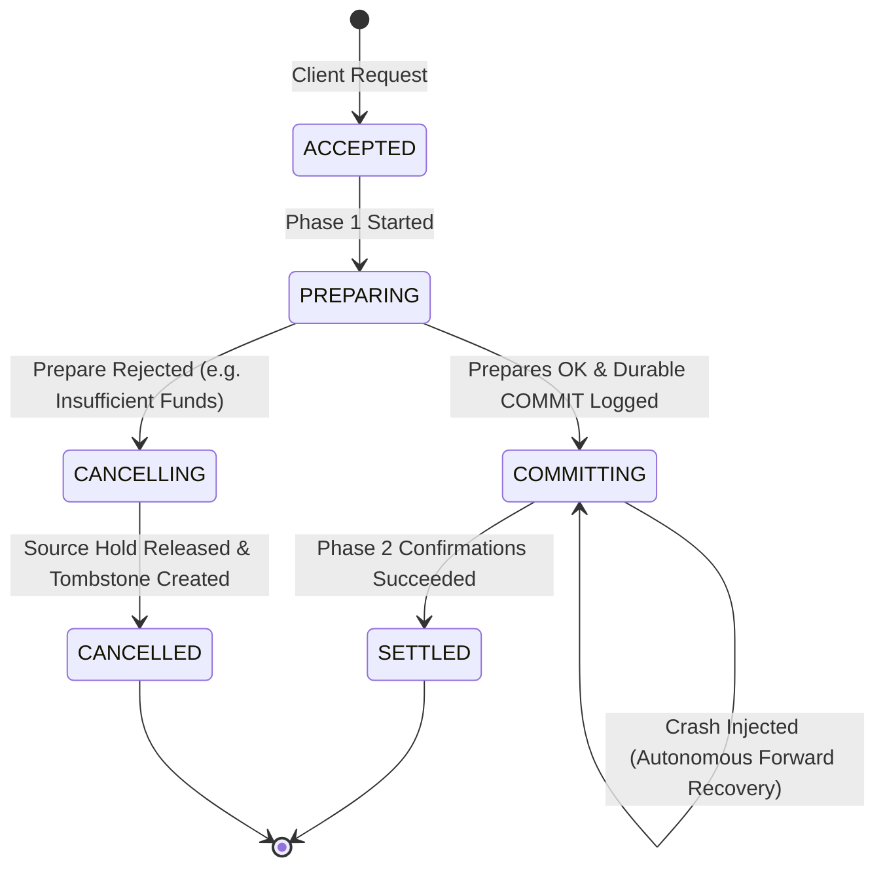

# LedgerGuard Distributed Transfer Protocol: Application-Level Reserve/Confirm/Cancel (TCC-Style)

## 1. Protocol Classification & Guarantees

LedgerGuard implements an **application-level reserve/confirm/cancel protocol (TCC-style)** across three independent PostgreSQL database instances (Coordinator DB, Source Ledger DB, Destination Ledger DB).

**Technical Guarantees & Non-Claims:**
- **Locally Atomic Only:** Each participant operation (`source_prepare`, `destination_prepare`, `source_confirm`, `destination_confirm`) executes as an independent, locally atomic transaction that commits immediately in PostgreSQL.
- **Not Database-Native 2PC:** Does **not** use PostgreSQL `PREPARE TRANSACTION` or `COMMIT PREPARED`. No database connections or table locks are held open across network calls.
- **Durable Decision Invariant:** The coordinator logs a mutually exclusive decision (`COMMIT` or `CANCEL`) before initiating Phase 2.
- **Forward Recovery:** After a `COMMIT` decision is logged, failures always recover forward to settlement. Unilateral rollback or premature refund is architecturally forbidden.
- **Non-Global Visibility:** Cross-database visibility is not globally instantaneous. An in-flight window exists where source funds are debited to clearing before destination credit completes.

## 2. Protocol Sequence & Failpoints

```mermaid
sequenceDiagram
    autonumber
    actor Client
    participant Coord as Coordinator
    participant L1 as Source Ledger (L1)
    participant L2 as Dest Ledger (L2)

    Client->>Coord: POST /v1/transfers (Idempotency-Key)
    Note over Coord: 1. Idempotency Check & Hash Fingerprint
    Note over Coord: 2. State: ACCEPTED

    rect rgb(20, 30, 45)
        Note over Coord, L2: Phase 1: Distributed Prepare
        Coord->>L1: source_prepare(transfer_id, amount)
        L1->>L1: Verify balance, create ACTIVE hold, decrease available
        L1-->>Coord: Source Prepared OK
        Note over Coord: [Failpoint: FAIL_AFTER_SOURCE_PREPARE_REPLY]

        Coord->>L2: destination_prepare(transfer_id, amount)
        L2->>L2: Verify recipient active, record PREPARED intent
        L2-->>Coord: Dest Prepared OK
    end

    rect rgb(30, 45, 25)
        Note over Coord: Durable Decision Point
        Coord->>Coord: Atomically log decision = COMMIT in transfer_decisions
        Note over Coord: State: COMMITTING
        Note over Coord: [Failpoint: FAIL_AFTER_COMMIT_BEFORE_SOURCE_CONFIRM]
    end

    rect rgb(25, 30, 45)
        Note over Coord, L2: Phase 2: Source-First Settlement
        Coord->>L1: source_confirm(transfer_id)
        L1->>L1: Consume hold, post journal: Debit Cash / Credit Clearing
        L1-->>Coord: Source Settled OK
        Note over Coord: [Failpoint: FAIL_AFTER_SOURCE_CONFIRM_BEFORE_DEST_CONFIRM]

        Coord->>L2: destination_confirm(transfer_id)
        L2->>L2: Post journal: Debit Clearing / Credit Recipient Wallet
        L2-->>Coord: Dest Settled OK
        Note over Coord: [Failpoint: FAIL_AFTER_DEST_CONFIRM_REPLY]
    end

    Note over Coord: State: SETTLED
    Coord-->>Client: 200 OK (Status: SETTLED)
```

---

## 2. State Machine Transitions

---

## 3. Failure Invariants

| Failure Scenario | Injected Fault | System Invariant Maintained |
| :--- | :--- | :--- |
| **Lost Source Prepare Response** | `FAIL_AFTER_SOURCE_PREPARE_REPLY` | Idempotent retry discovers existing hold; zero duplicate hold created. |
| **Destination Reject / Freeze** | Destination Prepare returns `REJECTED` | Coordinator logs `CANCEL`; source hold is released immediately; zero funds lost. |
| **Crash After COMMIT Decision** | `FAIL_AFTER_COMMIT_BEFORE_SOURCE_CONFIRM` | **Signature Scenario:** Source hold remains intact; coordinator logs `COMMIT`; forward recovery settles Phase 2; **zero refund or rollback**. |
| **Crash Between Confirmations** | `FAIL_AFTER_SOURCE_CONFIRM_BEFORE_DEST_CONFIRM` | Source settlement is committed; forward recovery completes destination settlement; clearing balances restore to zero. |
| **Lost Destination Confirm Reply** | `FAIL_AFTER_DEST_CONFIRM_REPLY` | Idempotent destination confirm re-executes; command inbox returns original receipt; zero double-credit. |
| **Cancel Arrives Before Prepare** | Network reordering | Source stores `CANCELLED` tombstone; delayed prepare rejects with zero hold. |
