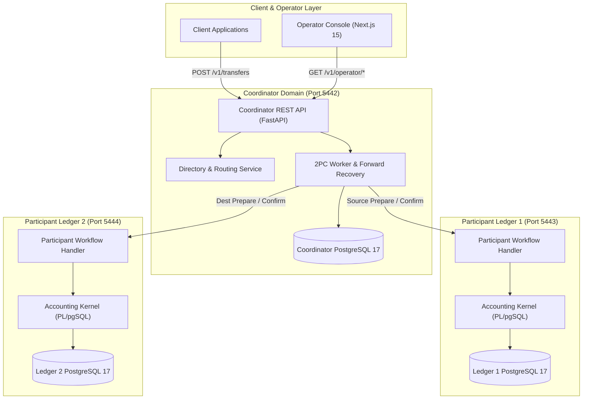

# LedgerGuard System Architecture

## 1. System Overview

LedgerGuard is an immutable, multi-ledger accounting kernel and distributed transaction orchestrator built to demonstrate financial correctness, deterministic concurrency control, and zero-loss failure recovery across independent failure domains.

---

## 2. Component Responsibilities

### 2.1. Accounting Kernel (`src/ledgerguard/participant/`)
- Encapsulates the immutable double-entry journal core.
- Enforces integer paise amounts, INR single-currency bounds, and balanced posting triggers.
- Maintains authoritative account balances with deterministic row-level locking (`account_balances FOR UPDATE ORDER BY account_id ASC`).
- Enforces role separation: application role (`ledgerguard_app`) is restricted from direct DML and must invoke `post_journal` stored procedures.

### 2.2. Directory & Routing Service (`src/ledgerguard/coordinator/directory_service.py`)
- Maps customer accounts to authoritative participant ledger instances.
- Manages customer onboarding and idempotent account provisioning lifecycle (`PROVISIONING` $\rightarrow$ `READY`).

### 2.3. Distributed TCC Orchestrator (Reserve/Confirm/Cancel) (`src/ledgerguard/worker/orchestrator.py`)
- Coordinates cross-ledger transfers between independent database instances.
- Executes Phase 1 prepares, logs durable coordinator decisions (`COMMIT` / `CANCEL`), and drives source-first Phase 2 settlements.
- Implements autonomous forward recovery: crashes after commitment recover forward to settlement and never trigger rollbacks or refunds.

### 2.4. Cross-Ledger Reconciliation Engine (`src/ledgerguard/coordinator/reconciliation.py`)
- Probes multi-database reachability with strict timeouts.
- Flags partial reachability as `INCOMPLETE` (prohibits false global `PASS`).
- Validates active holds against cached balances and audits cross-ledger clearing conservation:
  $$\sum \text{Clearing Balances} = 0$$

### 2.5. Operator Console (`apps/console/`)
- Next.js 15 / TypeScript interface providing 5 real-time screens:
  1. **Overview:** System topology, ledgered totals, net clearing balance, active holds, 24h volume.
  2. **Accounts Explorer:** Balance cards, account status lifecycle, and full journal statement modals.
  3. **Transfer Explorer:** Searchable transaction history with interactive 2PC lifecycle stepper.
  4. **Reconciliation Runner:** Cross-database audit execution with Stopped-and-Drained verification.
  5. **Experiment Console:** Interactive fault injector demonstrating signature failure and forward recovery.
