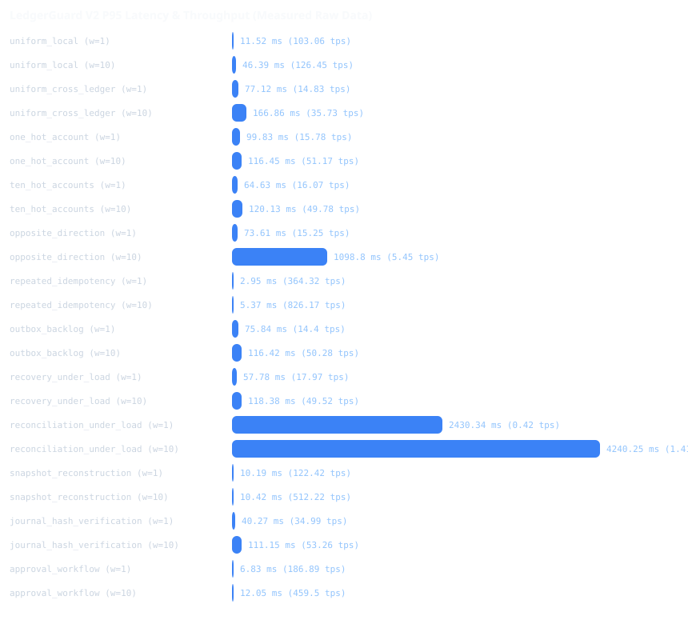

# LedgerGuard V2 Concurrency & Performance Baseline

- **Generated:** `2026-11-26T06:06:16.081576+00:00`
- **Git SHA:** `aa1c102`
- **Seed:** `42`
- **Environment:** `{"os": "Darwin", "release": "25.6.0", "python": "3.12.13", "cpu_count": 12}`
- **Reproduce Command:** `uv run python scripts/run_v2_perf_study.py --seed 42`

> **Scope Note:** Measurements below reflect controlled local Docker PostgreSQL 17 triad runs and do not claim production bank-scale throughput. Deterministic resource ordering plus bounded retry prevented caller-visible failures in the documented PostgreSQL contention campaign.

## Root-Cause Correction: Opposite-Direction Contention

- **Original Failure (`62dc0bd`):** `opposite_direction` at `workers=10`, `measured_ops=6` recorded `failure_count=1`, `error_rate=16.67%`, `deadlocks=1`.
- **Root Cause:** Lock-order inversion inside `source_confirm()` (`migrations/ledger/005_intents_holds_inbox_outbox.sql`) on `account_balances`: `source_confirm` updated the customer wallet row first and then called `post_journal()`, which locked `(CLEARING_ACCOUNT_ID, customer_account_id)` in `account_id ASC` order (`00000000-... < customer_uuid`). Concurrent `destination_confirm()` calls entered `post_journal()` and locked `CLEARING_ACCOUNT_ID` first, forming a 2-transaction deadlock cycle (`SQLSTATE 40P01`).
- **Correction:** Forward migration `migrations/ledger/009_fix_source_confirm_lock_ordering.sql` acquires `FOR UPDATE` on both `account_balances` rows in `ORDER BY account_id ASC` before updating `held_amount_minor`, paired with bounded exponential-backoff retry (`src/ledgerguard/db/retry.py`) for transient PostgreSQL `40P01`/`40001` errors.
- **Verification Workload:** Increased `opposite_direction` to `100` measured operations per worker level (`1` and `10` workers) with `warmup_ops=2` and fixed `seed=42`.

| Profile | Workers | Measured Ops | Success | Fail | Error Rate | Throughput (tps) | P50 (ms) | P95 (ms) | P99 (ms) | Max (ms) | Deadlocks | Retries |
| :--- | ---: | ---: | ---: | ---: | ---: | ---: | ---: | ---: | ---: | ---: | ---: | ---: |
| `uniform_local` | 1 | 6 | 6 | 0 | 0.00% | 75.55 | 12.45 | 14.71 | 14.71 | 14.71 | 0 | 0 |
| `uniform_local` | 10 | 6 | 6 | 0 | 0.00% | 100.03 | 28.07 | 58.27 | 58.27 | 58.27 | 0 | 0 |
| `uniform_cross_ledger` | 1 | 6 | 6 | 0 | 0.00% | 14.91 | 63.14 | 82.63 | 82.63 | 82.63 | 0 | 0 |
| `uniform_cross_ledger` | 10 | 6 | 6 | 0 | 0.00% | 35.56 | 149.18 | 166.5 | 166.5 | 166.5 | 0 | 0 |
| `one_hot_account` | 1 | 6 | 6 | 0 | 0.00% | 19.29 | 49.5 | 57.77 | 57.77 | 57.77 | 0 | 0 |
| `one_hot_account` | 10 | 6 | 6 | 0 | 0.00% | 43.79 | 107.83 | 134.64 | 134.64 | 134.64 | 0 | 0 |
| `ten_hot_accounts` | 1 | 6 | 6 | 0 | 0.00% | 15.82 | 60.97 | 68.79 | 68.79 | 68.79 | 0 | 0 |
| `ten_hot_accounts` | 10 | 6 | 6 | 0 | 0.00% | 37.02 | 124.63 | 159.15 | 159.15 | 159.15 | 0 | 0 |
| `opposite_direction` | 1 | 100 | 100 | 0 | 0.00% | 17.56 | 57.34 | 65.88 | 76.21 | 90.0 | 0 | 0 |
| `opposite_direction` | 10 | 100 | 100 | 0 | 0.00% | 76.81 | 123.48 | 162.39 | 170.28 | 171.73 | 0 | 0 |
| `repeated_idempotency` | 1 | 6 | 6 | 0 | 0.00% | 294.49 | 3.0 | 4.21 | 4.21 | 4.21 | 0 | 0 |
| `repeated_idempotency` | 10 | 6 | 6 | 0 | 0.00% | 887.81 | 4.35 | 5.26 | 5.26 | 5.26 | 0 | 0 |
| `outbox_backlog` | 1 | 6 | 6 | 0 | 0.00% | 14.75 | 66.75 | 72.44 | 72.44 | 72.44 | 0 | 0 |
| `outbox_backlog` | 10 | 6 | 6 | 0 | 0.00% | 62.63 | 84.32 | 95.12 | 95.12 | 95.12 | 0 | 0 |
| `recovery_under_load` | 1 | 6 | 6 | 0 | 0.00% | 17.15 | 56.21 | 69.12 | 69.12 | 69.12 | 0 | 0 |
| `recovery_under_load` | 10 | 6 | 6 | 0 | 0.00% | 53.27 | 102.96 | 110.89 | 110.89 | 110.89 | 0 | 0 |
| `reconciliation_under_load` | 1 | 6 | 6 | 0 | 0.00% | 0.56 | 1616.32 | 2631.96 | 2631.96 | 2631.96 | 0 | 0 |
| `reconciliation_under_load` | 10 | 6 | 6 | 0 | 0.00% | 2.21 | 2703.13 | 2711.42 | 2711.42 | 2711.42 | 0 | 0 |
| `snapshot_reconstruction` | 1 | 6 | 6 | 0 | 0.00% | 91.79 | 10.02 | 14.81 | 14.81 | 14.81 | 0 | 0 |
| `snapshot_reconstruction` | 10 | 6 | 6 | 0 | 0.00% | 228.86 | 18.81 | 25.38 | 25.38 | 25.38 | 0 | 0 |
| `journal_hash_verification` | 1 | 6 | 6 | 0 | 0.00% | 61.3 | 15.53 | 19.04 | 19.04 | 19.04 | 0 | 0 |
| `journal_hash_verification` | 10 | 6 | 6 | 0 | 0.00% | 82.17 | 48.5 | 71.64 | 71.64 | 71.64 | 0 | 0 |
| `approval_workflow` | 1 | 6 | 6 | 0 | 0.00% | 199.29 | 5.0 | 5.04 | 5.04 | 5.04 | 0 | 0 |
| `approval_workflow` | 10 | 6 | 6 | 0 | 0.00% | 913.85 | 5.41 | 5.94 | 5.94 | 5.94 | 0 | 0 |
